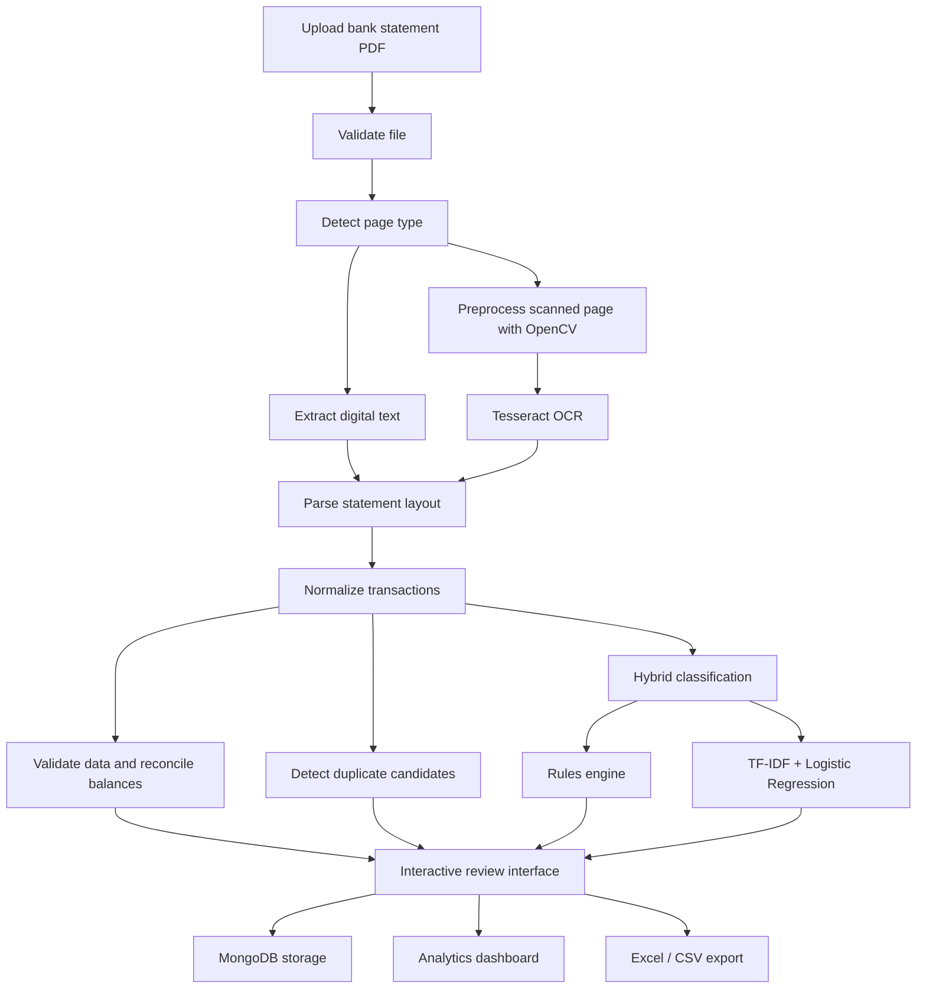

# FinExtract
### Intelligent Bank Statement Processing & Classification Platform

FinExtract is a privacy-focused financial document processing application that converts bank statement PDFs into structured, normalized, categorized, and reviewable transaction data. It combines PDF text extraction, OCR, layout-aware parsing, financial validation, hybrid transaction classification, analytics, and Excel/CSV export in one Streamlit interface.

> **Project submission:** Befree AI & Automation Assessment  
> **Core principle:** Deterministic, non-LLM processing. Financial statement data is not sent to external generative AI services by the application.

---

## Overview

Bank statements arrive in different formats and may contain digital text, scanned images, inconsistent column layouts, multi-line descriptions, and debit/credit indicators. FinExtract automates much of this workflow while keeping validation and manual review available.

### Key capabilities

- **PDF ingestion:** Accepts text-based, scanned, and mixed-content PDF statements.
- **Automatic PDF detection:** Inspects pages and chooses text extraction or OCR as appropriate.
- **Text extraction and OCR:** Uses PyMuPDF/pdfplumber for digital text and Tesseract OCR with OpenCV preprocessing for scanned pages.
- **Layout-aware parsing:** Handles multiple common statement layouts, including separate debit/credit columns, single amount with Dr/Cr indicators, and multi-line transaction descriptions.
- **Bank format detection:** Includes parser adapters for HDFC, ICICI, SBI, and Axis statements, with a generic parser for supported layouts.
- **Transaction normalization:** Standardizes dates, descriptions, debit/credit values, balances, and account metadata.
- **Hybrid classification:** Uses configurable deterministic rules first, then a traditional ML model based on TF-IDF features and Logistic Regression.
- **Financial validation:** Checks transaction data and running-balance continuity; flags potential issues for review.
- **Duplicate detection:** Identifies possible duplicate transactions using transaction fingerprints.
- **Human-in-the-loop review:** Allows category corrections that can be saved and reflected in analytics and exports.
- **Analytics dashboard:** Presents cash-flow summaries, transaction insights, and trends.
- **Export:** Generates Excel workbooks and CSV reports.
- **Persistent storage:** Uses MongoDB for application data, with an in-memory session fallback when the database is unavailable.
- **Containerized deployment:** Docker Compose runs the Streamlit application and MongoDB services.

---

## Application workflow



## Technology stack

| Layer | Technologies |
|---|---|
| User interface | Streamlit, custom CSS, Plotly |
| Application logic | Python |
| PDF extraction | PyMuPDF, pdfplumber |
| OCR & image processing | Tesseract OCR, pytesseract, OpenCV, Pillow |
| Machine learning | scikit-learn, TF-IDF, Logistic Regression |
| Data processing | Pandas, NumPy |
| Database | MongoDB 8.0, PyMongo |
| Excel export | OpenPyXL |
| Containerization | Docker, Docker Compose |
| Model persistence | Joblib |

---

## Repository structure

```text
FinExtract/
├── app.py
├── requirements.txt
├── Dockerfile
├── docker-compose.yml
├── docker-compose.dev.yml
├── .env.example
├── .dockerignore
├── .gitignore
├── .streamlit/
│   └── config.toml
├── assets/
│   └── logo.png
├── data/
│   └── training_transactions.csv
├── models/
│   ├── transaction_classifier.joblib
│   └── transaction_classifier_meta.json
├── mongo-init/
│   └── 01-create-app-user.js
├── samples/
│   ├── text_statement.pdf
│   ├── text_statement_layout_b.pdf
│   ├── text_statement_layout_c.pdf
│   ├── scanned_statement.pdf
│   ├── mixed_statement.pdf
│   └── sample transaction and ground-truth files
├── scripts/
│   ├── generate_sample_statements.py
│   └── generate_training_data.py
└── src/
    ├── analytics/
    ├── classification/
    ├── database/
    ├── exporters/
    ├── extraction/
    ├── parsers/
    ├── processing/
    ├── ui/
    └── utils/
```

---

## Getting started

### Option 1 — Run with Docker Compose (recommended)

**Prerequisites**
- Docker Desktop (Windows/macOS) or Docker Engine
- Docker Compose

1. Clone the repository and enter the project directory:

   ```bash
   git clone https://github.com/vrujal27/FinExtract.git
   cd FinExtract
   ```

2. Create your environment file:

   **Windows**
   ```powershell
   Copy-Item .env.example .env
   ```

   **Linux/macOS**
   ```bash
   cp .env.example .env
   ```

3. Review `.env` and replace all sample passwords with strong local values.

4. Build and start the services:

   ```bash
   docker compose up --build -d
   ```

5. Open the application:

   **http://localhost:8501**

Useful commands:

```bash
# Follow application logs
docker compose logs -f app

# Check running containers
docker compose ps

# Stop services (database volume is retained)
docker compose down

# Stop services and remove the database volume (destructive)
docker compose down -v
```

### Option 2 — Run locally

**Prerequisites**
- Python 3.11+
- MongoDB (optional; the application can use in-memory session mode)
- Tesseract OCR for scanned statement processing

1. Create and activate a virtual environment:

   **Windows**
   ```powershell
   python -m venv .venv
   .venv\Scripts\Activate.ps1
   ```

   **Linux/macOS**
   ```bash
   python -m venv .venv
   source .venv/bin/activate
   ```

2. Install dependencies:

   ```bash
   pip install -r requirements.txt
   ```

3. Copy `.env.example` to `.env` and configure `MONGODB_URI` for your local MongoDB instance, if using one.

4. Install Tesseract OCR and ensure it is available on your system `PATH`. On Windows, if needed, set `TESSERACT_CMD` in `.env` to the installed executable path.

5. Launch the application:

   ```bash
   streamlit run app.py
   ```

6. Visit **http://localhost:8501**.

---

## Configuration

FinExtract reads its runtime configuration from environment variables. Use `.env.example` as the reference template.

| Variable | Purpose |
|---|---|
| `MONGODB_URI` | MongoDB connection URI |
| `MONGO_DATABASE` | Database name |
| `MONGO_ROOT_USERNAME` | MongoDB root username for container initialization |
| `MONGO_ROOT_PASSWORD` | MongoDB root password for container initialization |
| `MONGO_APP_USERNAME` | Application database username |
| `MONGO_APP_PASSWORD` | Application database password |
| `MAX_UPLOAD_MB` | Maximum PDF upload size in MB |
| `MAX_PAGES` | Maximum number of PDF pages to process |
| `OCR_DPI` | Rendering resolution used by OCR |
| `TESSERACT_CMD` | Optional path to the Tesseract executable |
| `TEST_MONGODB_URI` | Optional separate MongoDB URI for testing |

> Never commit your real `.env` file, production credentials, or confidential bank statements. Keep `.env` local and use `.env.example` with placeholder values in the repository.

---

## Machine-learning model

FinExtract uses a traditional, locally executed text classification pipeline:

1. Transaction descriptions are cleaned and normalized.
2. Configurable rule-based patterns are evaluated first.
3. Transactions not resolved by the rules are classified using TF-IDF features and Logistic Regression.
4. Low-confidence results can be reviewed and corrected by a user.

The project includes a trained model artifact in `models/`. To regenerate synthetic sample statements and training data, run:

```bash
python scripts/generate_sample_statements.py
python scripts/generate_training_data.py
```

To retrain the classifier:

```bash
python -c "from src.classification.train_model import train_classifier; train_classifier()"
```

**No LLM training is required.** The classifier is a conventional machine-learning model, not a generative AI model.

---

## Sample files for demonstration

The `samples/` directory contains synthetic example statements intended for local testing and demonstration, including text-based, scanned, mixed-content, and multiple-layout PDFs. Use these sample files to explore ingestion, extraction, validation, classification, and export features.

Do not use real customer or personal financial statements in public demonstrations or commit them to a public repository.

---

## Security & privacy

- The application is designed for local/on-premise processing and does not rely on external LLM APIs for transaction classification.
- Account identifiers are masked in relevant processing and presentation flows.
- File validation and safe temporary-file handling are included in the ingestion workflow.
- Docker Compose configures MongoDB with a dedicated application user.
- Credentials should be configured locally through `.env` and never committed.
- Public repositories should contain synthetic/sample data only.

> This project is an assessment/demo application. Review the deployment configuration, access controls, logging, retention policies, and security requirements before using it with sensitive or production financial data.

---

## Known limitations

- OCR quality may decrease for low-resolution, skewed, noisy, or handwritten statements.
- Bank-specific formats can vary by statement version; unfamiliar layouts may require parser adjustments.
- Password-protected or encrypted PDFs may be rejected by the current validation workflow.
- Automated classification and reconciliation are aids to review; users should verify flagged or uncertain transactions before relying on exported results.

## Potential future enhancements

- Expand parser coverage for additional banks and statement templates.
- Improve OCR table and column detection for difficult scans.
- Add configurable multi-currency handling.
- Incorporate reviewed corrections into a controlled model-retraining workflow.
- Add further automated regression and integration testing.

---

## Assessment highlights

FinExtract demonstrates the integration of:

- PDF processing and OCR
- Data cleaning and normalization
- Rule-based systems and traditional machine learning
- Financial validation and reconciliation
- MongoDB persistence
- Interactive analytics and data visualization
- Excel/CSV report generation
- Docker-based application deployment


